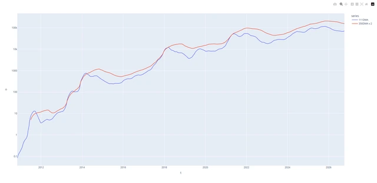

# btc_all_Indicators

Инструменты для сравнения цены Bitcoin с рыночными индикаторами. Скрипты получают данные из внешних API, приводят даты и числовые значения к единому виду и строят интерактивные графики. Отдельные эксперименты посвящены данным Glassnode: SOPR, Stock-to-Flow и Pi Cycle.

**Python-портфолио Евгения Толмачева** · Python · pandas · Plotly · Requests · openpyxl



## Возможности

- Загружает историю цены Bitcoin из Blockchain.com и отображает её с логарифмической шкалой.
- Сопоставляет цену с индексом страха и жадности из Alternative.me.
- Рассчитывает скользящие средние индекса и показывает несколько рядов на одном графике.
- Сохраняет промежуточные данные индекса в Excel; отдельные скрипты запрашивают ончейн-метрики Glassnode.

## Как устроен проект

### История цены

[`btc.py`](btc.py)

Запрос цены, преобразование UNIX-времени и настройка осей, сетки и интерактивного курсора.

### Сравнение индикаторов

[`fear_and_greed_index.py`](fear_and_greed_index.py)

Загрузка двух источников, обработка таблиц, сглаживание индекса и объединение графиков.

### Ончейн-данные

[`glassnode-sopr.py`](glassnode-sopr.py), [`glassnode-stock-to-flow.py`](glassnode-stock-to-flow.py), [`glassnode-py-cicle.py`](glassnode-py-cicle.py)

Отдельные API-запросы к Glassnode и эксперименты с представлением полученных метрик.

## Технологии и их роль

- **Requests**: Получение JSON из API Blockchain.com, Alternative.me и Glassnode.
- **pandas и openpyxl**: Подготовка временных рядов, скользящие средние и чтение/запись Excel.
- **Plotly**: Интерактивные линии, общие оси, легенды и логарифмический масштаб.

## С чего начать просмотр кода

Начните с btc.py, затем посмотрите fear_and_greed_index.py: здесь виден переход от одного графика к обработке и сопоставлению нескольких источников данных.

## Подготовка и запуск

Создайте отдельное окружение и установите исходные зависимости:

```powershell
python -m venv .venv
.venv\Scripts\Activate.ps1
python -m pip install -r requirements.txt
```

Скрипты Glassnode используют YOUR_API_KEY. Для отдельных графиков нужны локальные Excel-файлы test.xlsx и output1.xlsx. Доступность исторических API и тарифов необходимо проверить перед запуском.

После подготовки настроек и необходимых данных основная точка входа:

```powershell
python btc.py
```

`requirements.txt` сохранён из проекта. Это снимок окружения, а не гарантия совместимости с новейшей версией Python. Для старых проектов могут потребоваться соответствующая версия Python и настройка системных компонентов.

## Структура

```text
btc_all_Indicators/
├── .data_support/
│   └── data_provider.py
├── docs/
│   └── preview.webp
├── .gitignore
├── btc.py
├── fear_and_greed_index.py
├── glassnode-py-cicle.py
├── glassnode-sopr.py
├── glassnode-stock-to-flow.py
├── README.md
└── requirements.txt
```

## Контекст и ограничения

Проект начат в 2022 году как практика работы с HTTP API, временными рядами и визуализацией. Он состоит из самостоятельных исследовательских скриптов: для каждого источника данных предусмотрены свои подготовка таблицы и построение графика.

Проверены синтаксис Python-файлов и состав публикации. Полный запуск этой версии с внешними сервисами, локальными данными или моделями не выполнялся; команды выше описывают подготовку по исходникам.

## Состав репозитория

Сохранены авторские исходники, их имена и структура, зависимости и компактный скриншот. Рабочие базы, наборы данных, модели и виртуальные окружения исключены. Секреты заменены обозначениями `YOUR_...` / `REDACTED_...`; реальные значения задаются локально. Исходные алгоритмы при оформлении портфолио не перерабатывались.

Автор: [Евгений Толмачев](https://github.com/EvgenyET) · [Портфолио](https://evgeny.tech/)
